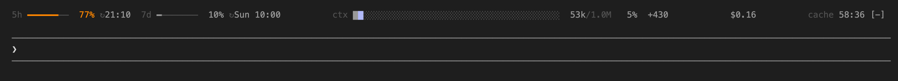
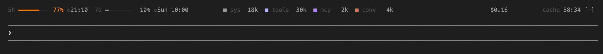

# status-bar

The missing status bar for Claude Code, showing usage: 5h/7d rate limits with reset times, context fill, session cost and the prompt cache timer. It draws one line above the prompt, and other mods can add their own segments.



With the pointer over `ctx`, the legend shows in the same cells:



| Segment id | Shows |
| --- | --- |
| `limit5h` | The 5-hour rate-limit window, as the last API response reported it, and its reset time in local 24h time: `5h ━━──────  25% ↻12:20`. Hover to see the time until the reset: `5h resets in 2h 34m 23s`. |
| `limit7d` | The 7-day rate-limit window and its reset day and time: `7d ━─────── 12% ↻Mon 09:00`. Hover to see the time until the reset. |
| `limitSpend` | The account's spend limit as a percentage, when Claude Code reports one (an Enterprise seat's usage budget, a gateway spend limit): `spend ━───────  10%`. Claude Code gives no dollar figure. Hover to see the time until the reset, when Claude Code reports one. |
| `ctx` | The context window fill, then the tokens the last main-thread turn added: `62k/200k  31% +4.1k`. Each cell has the color of the group that fills it. Hover over the segment to see the legend in its place (see below). The delta reads `+--` until the bar has an earlier figure to compare with (after the first or second turn). It starts again after `/clear` and is negative after a compaction. The percentage turns blue, orange and magenta above 50%, 75% and 90% of the window, or of `contextLimit` when that is lower. |
| `legend` | The context split: system prompt and memory (`sys`), built-in tools (`tools`), MCP tools (`mcp`), messages (`conv`). Not in the default bar: use `ctx+legend` on a terminal without mouse support. |
| `cost` | The session cost, for example `$1.24`. With a `budgetUsd` above 0, also the budget, a meter and the percentage: `$1.24 / $10 ━─────── 12%`. |
| `cache` | The time (mm:ss) until the prompt cache expires, counted from the last main-thread response. |

The `5h`, `7d`, spend and budget meters turn blue above 50%, orange above 75% and magenta above 90%. The cache timer uses the same colors for the elapsed part of the TTL. The other segments show `--` placeholders until the data arrives, so the bar does not change shape. When the bar does not fit, it drops the `legend` segment and shrinks the context bar. Below 110 columns, or when that is not enough, it uses a narrow form without the 5h, 7d and budget meters, the reset times and the context delta. If the narrow form is too wide, the groups at the right go.

**Plan detection.** The limit segments show only the windows that your account reports. A Pro or Max plan shows `5h` and `7d`. An Enterprise seat has no 5h or 7d window, so it shows `spend` in their place. Before the first API response of the process, the bar shows no limit segment. An account that reports no window (for example an API key) shows no limit segment. The windows stay on the bar after `/clear`, because they belong to the account and not to the conversation.

**Hover.** Move the pointer over a limit segment to see the time until its window resets, for example `5h resets in 2h 34m 23s`. Where the long form does not fit the segment's cells, it is shorter (`5h ↻2h 34m 23s`, then `↻2h 34m`). Move the pointer over `ctx` to see the legend (`■ sys  18k  ■ tools  30k …`) in the same cells, with no layout shift. Where the full legend does not fit, it is compact (`■ 18k ■ 30k …`). Hover works in the `above` and `below` positions, not in `status`. It needs a terminal that reports mouse movement.

## Setup

Install it from this repository's marketplace, in Claude Code:

```
/plugin marketplace add alesmenzel/claude-status-bar
/plugin install status-bar@alesmenzel
```

To get a new version, see [Updating](#updating).

### From a clone

Clone the repository:

```sh
git clone https://github.com/alesmenzel/claude-status-bar.git ~/claude-mods/claude-status-bar
```

Load it for one session:

```sh
claude --plugin-dir ~/claude-mods/claude-status-bar
```

Or load it in every session. Add this to your shell profile, or put the variable in the `env` block of `~/.claude/settings.json`:

```sh
export CLAUDE_CODE_PLUGIN_DIRS="$HOME/claude-mods/claude-status-bar"
```

The mod has no runtime dependencies. You do not need `npm install` to use it.

### Updating

Claude Code loads the mod when a session starts. After an update, restart Claude Code to use the new version.

From the marketplace:

1. Run `/plugin marketplace update alesmenzel` in Claude Code.
2. Restart Claude Code.

From a clone:

1. Pull the changes:

   ```sh
   git -C ~/claude-mods/claude-status-bar pull
   ```

2. Restart Claude Code.

Claude Code runs the files that are in the clone, on the branch that is checked out. A local change to the clone also applies after a restart.

A segment list that you set with `/status-bar segments` stays after an update. It overrides a new default. To use the default of the new version, set the `segments` option in the `/config` menu.

## Configuration

Set the options in the `/config` menu, or in `settings.json` under `pluginConfigs["status-bar"].options`. A change in `/config` applies immediately.

| Key | Default | Values |
| --- | --- | --- |
| `show` | `true` | `false` hides the bar. |
| `position` | `above` | `above`: a band above the prompt. `below`: under the prompt, after the hint line. `status`: plain text in the status line. |
| `segments` | `limit5h+limit7d+limitSpend,ctx,cost,cache` | `,` separates groups, which the bar spreads across the width. `+` joins segments in one group. Unknown ids are ignored. |
| `budgetUsd` | `0` | An optional budget of your own for one conversation, in USD. `0`: the cost segment shows the spend only. Claude Code gives mods no account budget in dollars. |
| `cacheTtl` | `1h` | `1h` or `5m`. |
| `contextLimit` | `0` | A lower context limit of your own, in tokens, for example `256000`. When it is lower than the model's window, `ctx` counts against it (`62k/256k  24%`). When the context goes past it, `ctx` counts against the model's window again (`320k/1.0M  32%`) and shows the window figure in magenta. `0` or a value above the window: the model's window. |

## Command

```text
/status-bar [on|off|toggle]              hide or show the bar (no argument: toggle; kept across sessions)
/status-bar position above|below|status  move the bar (kept across sessions)
/status-bar segments <list>              change the segments, e.g. limit5h,ctx,cost (kept across sessions)
```

- `/status-bar on` cannot show the bar when `show` is `false`.
- `position` and `segments` from the command apply immediately and do not change your settings. The mod keeps them in its own store, and they override the `/config` options.
- When you set `position` or `segments` in the `/config` menu, that value applies and the mod removes the stored override for that key. A hand edit of `settings.json` does not remove the override.

## Custom segments

Another mod can add a segment. List `status-bar` under `dependencies` in its `plugin.json`:

```json
{ "name": "status-bar-clock", "version": "0.1.0", "dependencies": ["status-bar"] }
```

Then publish the segment from any hook or timer:

```ts
import type { Register } from 'claude-code'

export const register: Register = on => {
  on('session.start', async ($, e, next) => {
    const result = await next(e)
    const publish = async () => {
      const time = new Date(await $.clock.now()).toTimeString().slice(0, 5)
      await $.statusBar.segment({
        id: 'clock',
        runs: [{ text: 'clock ', tone: 'label' }, { text: time }],
        narrowRuns: [{ text: time }], // optional: used on a narrow bar
        hoverRuns: [{ text: new Date().toDateString() }], // optional: shown in the same cells on hover
      })
    }
    await publish()
    $.clock.every(15_000, publish)

    return result
  })
}
```

- A run has `text`, an optional `tone` (`label` or `value`, the default) and an optional `color` (a theme key or `#rrggbb`).
- `hoverRuns` is optional. The bar pads the normal and the hover view to one width, so nothing moves. The status line never shows it.
- Add the id to `segments` to place it, for example `limit5h+limit7d,ctx,cost,cache,clock`.
- The bar draws new segment data on its 1-second tick.
- `$.statusBar.remove({ id })` removes a segment. Both calls return `{ id, isPlaced }`.
- A custom segment cannot replace a built-in id.

The full example is in [`examples/clock-segment`](examples/clock-segment). To try it, load both folders:

```sh
claude --plugin-dir . --plugin-dir ./examples/clock-segment
```

## Development

```sh
npm install          # TypeScript, for the type check
npm run typecheck    # tsc -p .
npm run validate     # claude plugin validate . (the manifest and the hooks module)
npm test             # claude plugin test . (tests/*.test.ts)
```

Claude Code writes the type declarations in `.claude-plugin/types/` when it loads the mod. Load the mod once with `--plugin-dir` before you run the type check.

Known limit: Claude Code keeps one blank row between the band and the prompt border.

## License

MIT, see [LICENSE.md](LICENSE.md).
